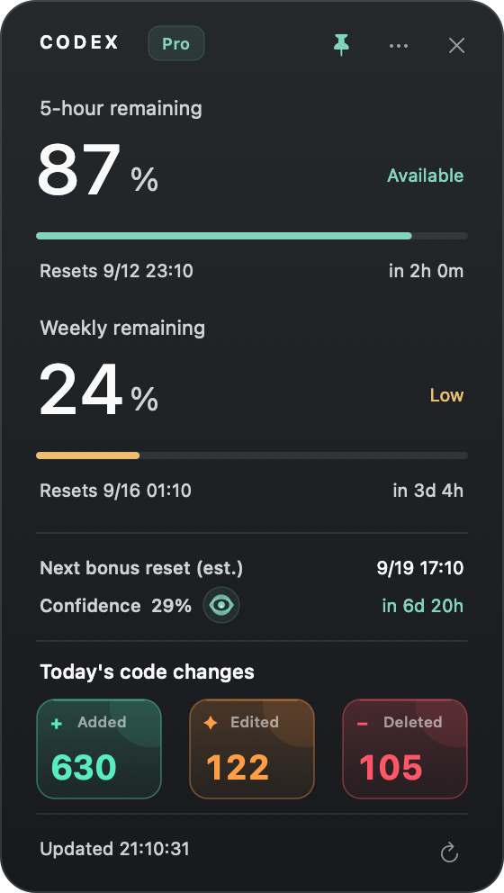

# Codex Quota

The expanded panel also shows **added, modified and deleted source lines** across locally saved Codex projects, refreshed in the background every 10 seconds.

The first scan of each day counts today's existing non-merge commits, then saves the current working copies as the zero point. Later staged, unstaged and committed changes are measured as a net diff from that daily baseline. Old uncommitted work therefore does not reappear every morning. Uncommitted edits made before the first launch that day cannot be reconstructed. Dates use committer time in the selected time zone. Replacement lines are paired within each diff hunk; remaining lines count as additions or deletions. Shared repositories are deduplicated, registered worktrees are included, and new, unignored source files are included. Source and test files include blank lines and comments; docs, configuration, binaries and common build/dependency paths are excluded. These are project changes from all authors and tools, not Codex-only output. Hover text marks incomplete results when a directory is unavailable. Discovery uses Codex's local storage and may need updates when its format changes.

After building, run `"Codex Quota.app/Contents/MacOS/CodexQuota" --code-activity-test` for fixture tests or `--code-activity-scan` for a single read-only scan of linked projects.

[中文](README.md) · English

View your remaining Codex quota in the macOS menu bar and a floating desktop widget.



## Requirements

- Apple Silicon (M-series) Mac running macOS 26 or later.
- Codex installed in the system Applications folder, with your account signed in.

## Download and launch (no build required)

Download the latest version directly: [Codex-Quota-latest-arm64.dmg](https://github.com/ccpua/codex-quota/releases/download/latest/Codex-Quota-latest-arm64.dmg):

1. Double-click the DMG.
2. Drag **Codex Quota.app** into your Applications folder.
3. Double-click **Codex Quota** to launch. Python and developer tools are not required.

If a DMG is not available, click **Code → Download ZIP** on this repository's page, extract it, and drag the included app into Applications.

This version has not been notarized by Apple. If macOS blocks the first launch because it cannot verify the developer, confirm that you downloaded it from this repository, then go to **System Settings → Privacy & Security → Open Anyway**. [Apple's instructions](https://support.apple.com/en-us/102445)

Hover over the capsule to see details, or drag it to move. Right-click to check for updates, change the language, appearance, or refresh interval, or quit.

## Reconnect a VPN when offline

Recovery runs silently in the background with the existing local shortcut configuration (for example, `reconnect VPN`), without menu controls or a configuration dialog. The internal preferences `vpnReconnectEnabled` and `vpnReconnectShortcutName` control whether it runs and which shortcut it invokes. Without configuration, it does not run.

Paste the [reconnect script](scripts/reconnect-vpn.applescript) into a **Run AppleScript** action. It reopens a closed main window through the tray's Show menu and selects Home, then waits for the disconnected state specifically before connecting again.

The script supports both legacy fixed identifiers and AmneziaVPN 5.1's generated QML identifiers. It matches the `ConnectButton` type without depending on numeric suffixes, and reads or presses a control only when exactly one matches. The updated Home tab is identified by its type and label.

Qt may replace accessibility objects as connection state changes. The script treats temporarily stale references as transitions and keeps polling so a successful reconnection does not produce a false failure. Permission errors still propagate.

When enabled, the app independently probes two general HTTPS endpoints at the refresh interval and reconnects only if neither is reachable. After a suspected quota transport failure, it instead checks the actual ChatGPT quota and OpenAI login endpoints so reachable unrelated sites cannot hide a failed VPN route. Both service routes must respond; a transport failure on either allows recovery. HTTP responses including 401, 403 and 500 still prove connectivity and do not trigger reconnects. Yellow can also indicate a quota error; the warning explains when connectivity checks pass, while skipped recovery details appear only in the log.

If a same-named Shortcuts-exported application exists in `~/Applications` or `/Applications`, it launches through LaunchServices using that app's own Accessibility authorization. Otherwise it runs `shortcuts run "shortcut name"`. Runs cannot overlap, and attempts are at least 180 seconds apart. The app refreshes quota after completion.

Immediately before every actual invocation, the app rereads macOS system VPN state using `scutil --nc list`. Any system VPN in `Connected` state skips that Amnezia reconnect. Unreadable or unrecognized state also skips it. A skipped attempt does not consume cooldown; after the other VPN disconnects, the next outage check reevaluates eligibility. This check never starts or stops other VPNs or guesses from `utun` interfaces. Third-party tunnels absent from the system VPN list are outside its scope.

Configure the shortcut and its Accessibility permissions first. macOS may still request permission on first invocation. Recovery execution details are written only to `~/Library/Logs/CodexQuota/vpn-recovery.log`; the UI shows connectivity and quota status. The feature is off by default, and does not modify VPN/shortcut configuration. Operation while locked or without an accessible window depends on the shortcut itself.

After building, run `"Codex Quota.app/Contents/MacOS/CodexQuota" --vpn-recovery-test` for mocked policy tests and harmless process tests. They do not run a real shortcut or change the VPN.

On macOS, run `python3 scripts/test-reconnect-vpn.py` to check legacy/generated identifiers, Chinese/English states, delayed disconnection and timeout handling. All UI operations are mocked; no real VPN is changed.


<details>
<summary>Optional: install from source</summary>

Requires Python 3.8+ and Xcode Command Line Tools (install with `xcode-select --install`). Run these commands in the project folder:

```sh
zsh build.sh
python3 install.py
open "$HOME/Applications/Codex Quota.app"
```

</details>

[MIT License](LICENSE)
