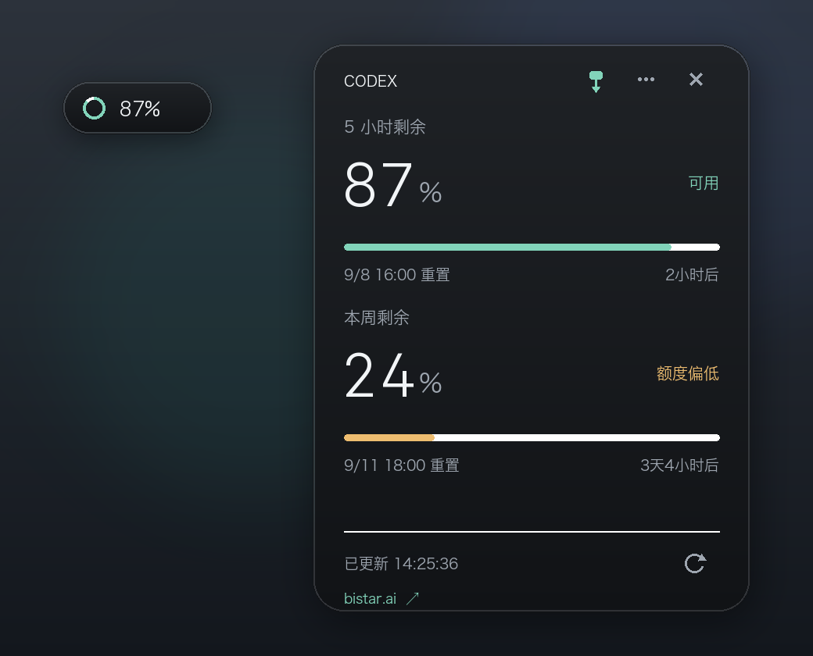

# Codex Quota

中文 · [English](README.en.md)

在 macOS 菜单栏和桌面小窗查看 Codex 剩余额度。



## 环境要求

- Apple Silicon（M 系列）Mac，macOS 26 或更新版本。
- 已安装并登录 Codex，放在系统“应用程序”文件夹中。

## 下载与启动（无需编译）

直接下载最新版：[Codex-Quota-latest-arm64.dmg](https://github.com/ccpua/codex-quota/releases/download/latest/Codex-Quota-latest-arm64.dmg)：

1. 双击 DMG。
2. 将 **Codex Quota.app** 拖到“应用程序”文件夹。
3. 双击 **Codex Quota** 启动，无需安装 Python 或开发工具。

没有 DMG 时，也可以在仓库页面点击 **Code → Download ZIP**，解压后将其中的 app 拖到“应用程序”文件夹。

当前版本尚未经过苹果公证。如果首次打开被提示无法验证开发者，请确认来自本仓库，再到 **系统设置 → 隐私与安全性 → 仍要打开**。[苹果操作说明](https://support.apple.com/zh-cn/102445)

鼠标悬停胶囊查看详情，拖动可调整位置；右键菜单可检查更新，或设置语言、外观和刷新间隔，也可退出程序。

## 网络异常时自动重连 VPN

此能力在后台静默运行，不提供菜单开关或配置窗口，沿用本机已保存的快捷指令配置（例如 `reconnect VPN`）。内部偏好 `vpnReconnectEnabled` 和 `vpnReconnectShortcutName` 控制是否启用及调用名称，未配置时不运行。

可将 [重连脚本](scripts/reconnect-vpn.applescript) 粘贴到快捷指令的 **Run AppleScript** 动作中。主窗口关闭时，它会从托盘菜单重新显示窗口并切换到首页；断开后等待明确的“已断开”状态再连接，避免界面异步更新时提前退出。

脚本同时兼容旧版固定按钮标识与 AmneziaVPN 5.1 的动态 QML 标识，按 `ConnectButton` 类型匹配，不依赖每次可能变化的数字后缀。找到唯一连接按钮后才读取状态或点击；新版首页标签也按类型与名称识别。

连接状态变化时，Qt 可能替换辅助功能对象。脚本会将临时失效的控件引用视为过渡状态并继续轮询，避免 VPN 已重连但脚本误报失败；权限类错误仍正常上报。

开启后，App 按刷新间隔独立检查两个通用 HTTPS 地址，只有两者都不可达时才自动重连。如果额度查询发生疑似网络错误，则改为检测实际使用的 ChatGPT 额度和 OpenAI 登录地址，避免通用网站可达掩盖 VPN 分流异常；任一服务地址无法建立 HTTPS 连接时才重连。HTTP 401、403、500 等响应仍视为网络可达，不会因为服务报错或登录失效而重连。黄色也可能表示额度查询异常；联网检测通过时，界面显示额度查询异常与联网正常，跳过 VPN 重连的原因仅写入日志。

如果 `~/Applications` 或 `/Applications` 中存在同名的 Shortcuts 导出应用，会优先通过 LaunchServices 启动这个应用，以使用它独立的辅助功能授权；否则执行 `shortcuts run "快捷指令名称"`。调用期间不重复运行，两次尝试至少间隔 180 秒。快捷指令完成后自动刷新额度。

每次实际调用前，都会重新执行 `scutil --nc list` 检查 macOS 系统 VPN 状态。如果已有系统 VPN 处于 `Connected`，则跳过本次 Amnezia 重连；无法读取或识别状态时也跳过。跳过不会消耗重连间隔，其他 VPN 断开后，下次检测到网络异常时会重新判断。此检查不启动或断开其他 VPN，也不通过 `utun` 接口猜测 VPN 状态；未注册到系统 VPN 列表的第三方隧道不在检测范围内。

快捷指令及其辅助功能权限需要事先配置。首次从 App 运行时，macOS 仍可能要求确认权限；重连执行详情仅写入 `~/Library/Logs/CodexQuota/vpn-recovery.log`，界面只显示网络与额度状态。App 不会修改你的 VPN 或快捷指令配置。该功能默认关闭；锁屏或没有可操作界面时，能否重连取决于快捷指令本身。

开发验证：构建后运行 `"Codex Quota.app/Contents/MacOS/CodexQuota" --vpn-recovery-test`。测试使用模拟网络状态和无害的系统命令，不运行真实快捷指令或切换 VPN。

脚本回归验证：在 macOS 运行 `python3 scripts/test-reconnect-vpn.py`，检查新旧标识、中英文状态、延迟断开与超时流程。所有界面操作均替换为模拟，不切换真实 VPN。


## 代码变更统计

悬浮卡片展示关联项目的**新增、修改、删除**源代码行数，每 10 秒在后台刷新。

- 自动读取本机 Codex 保存的项目，合并重复仓库，并检查各个 Git worktree。
- 汇总口径为**当天首次扫描前的今日提交 + 首次扫描后相对工作区基线的净变化**。首次扫描会把已有未提交内容作为零点，因此以前遗留的修改不会每天重新计入；如果当天编辑后才首次启动 App，启动前尚未提交的编辑无法回溯。
- 同一 diff 变更块内，将新增和删除行配对记为“修改”；其余分别计为“新增”和“删除”，三个数量不重复。连续提交对同一行的修改可分别计数。
- 今日按 App 所选时区和 Git 提交者时间计算，统计首次扫描前本机已有分支的非合并提交，不联网拉取远端记录。此后暂存、未暂存和新提交的内容都相对每日基线计算，并包含未被 Git 忽略的新源代码文件。
- 统计源代码及测试，包含空行、注释；不统计文档、配置、二进制及常见构建、第三方依赖目录。数字包含所有作者和工具的改动，不仅是 Codex 的产出。
- 非 Git 目录或扫描失败时，指标卡片的悬停提示会标记结果不完整；项目列表读取依赖 Codex 的本地存储格式，后续版本变化可能需要适配。

开发验证：构建后运行 `"Codex Quota.app/Contents/MacOS/CodexQuota" --code-activity-test`。使用 `--code-activity-scan` 可只读取一次真实项目统计并退出。

<details>
<summary>可选：从源码安装</summary>

需要 Python 3.8+ 和 Xcode Command Line Tools（运行 `xcode-select --install` 安装）。在项目文件夹中执行：

```sh
zsh build.sh
python3 install.py
open "$HOME/Applications/Codex Quota.app"
```

</details>

[MIT License](LICENSE)
